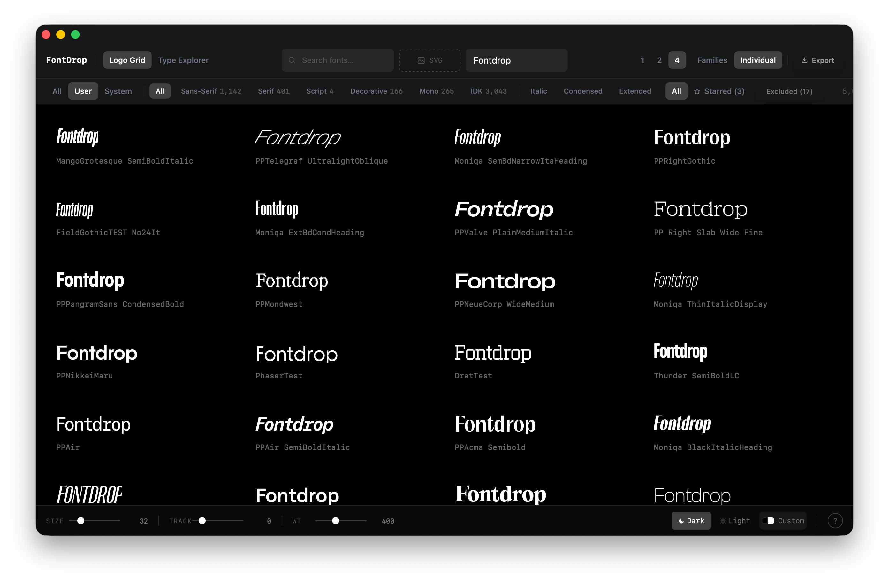

# FontDrop
A native Mac app for finding the type for a brand.
Browse every font on your Mac, find what pairs with it, and see why.


**Status:** v0.1.0-beta — unsigned pre-release. A redesign is in progress (see `docs/ideas/`).

## Install
1. Download `FontDrop_[version]_aarch64.dmg` from [Releases](../../releases)
2. Open the .dmg and drag FontDrop to Applications
3. First launch: right-click → Open (required for unsigned apps on macOS)

## How pairing works
FontDrop reads each font's own data: family name, x-height, cap height, stroke contrast, serifs, letter construction, vendor and designer. It scores candidates with lenses drawn from the typography literature, and every suggestion carries its evidence: what was measured, which source backs it, and how strongly that source states it. It shares reasoning. The designer decides.

- Rules and sources: [`docs/research/pairing-rulebook.md`](docs/research/pairing-rulebook.md)
- Benchmark of real-world pairs, and how to rebuild it: [`docs/research/benchmarks/`](docs/research/benchmarks/)

## Standing on the shoulders of
The pairing lenses come from close reading of these works. Any mistakes in turning them into code are ours.

- Tim Brown, *Flexible Typesetting* (and *Combining Typefaces*, through Matej Latin's method)
- Matej Latin, *Better Web Typography for a Better Web* and its cheat sheets
- Elliot Jay Stocks, *Universal Principles of Typography*, including Indra Kupferschmid's skeleton / flesh / skin font matrix
- Jeremiah Shoaf (Typewolf), *Flawless Typography Checklist* and his font-combination guides
- Smashing Magazine authors: Dan Mayer, Douglas Bonneville, Marko Dugonjić, Dan Reynolds
- Adam Wathan and Steve Schoger, *Refactoring UI*
- Beth Tondreau, *Layout Essentials*; Timothy Samara, *Making and Breaking the Grid*
- Nguyen Le, *Typography Playbook*; Yesenia Perez-Cruz, *Expressive Design Systems*
- Research: Jiang et al., "Visual Font Pairing" (2019); Jack Qiao's Fontjoy; Google Fonts' public metadata

## Develop
```bash
npm install
npm run tauri dev
```
Rust tests: `cd src-tauri && cargo test --lib`. The pairing evaluations are opt-in tests (`-- --ignored`); see the comments in `src-tauri/src/pairing.rs`.

## Built with
- Tauri v2 + Rust
- React + TypeScript + Tailwind
- Framer Motion

---
© 2026 Dyno Labs
