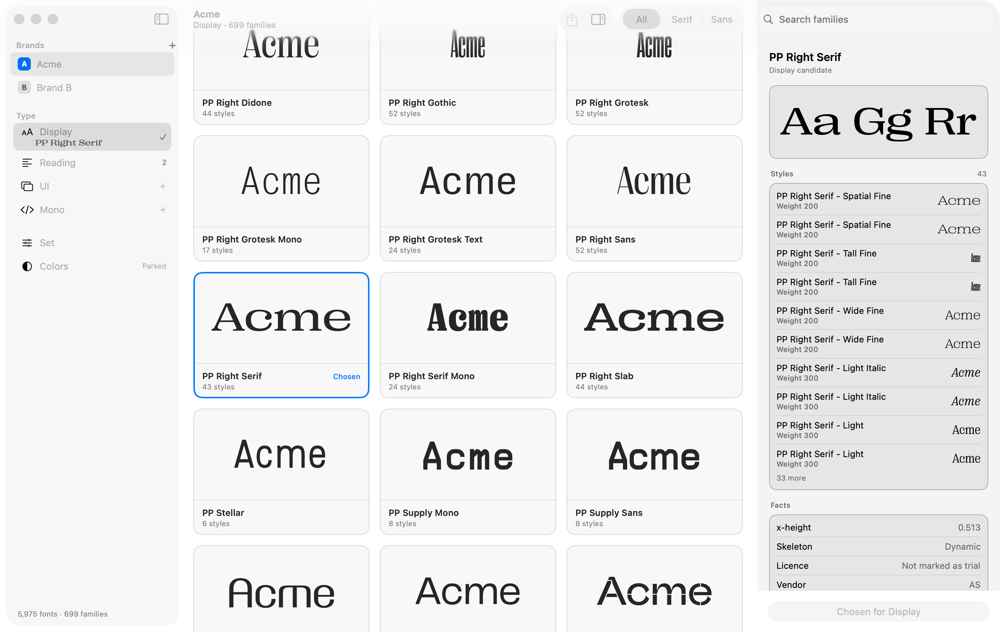
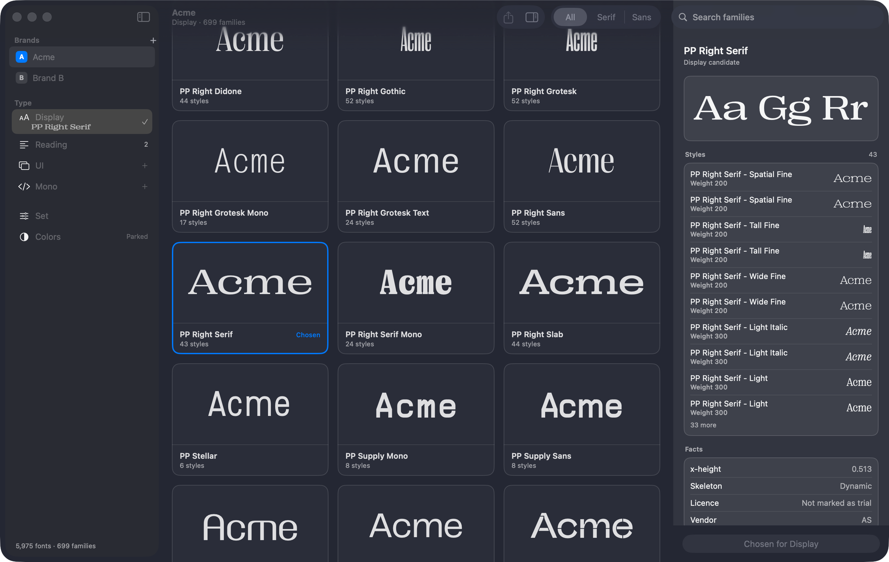
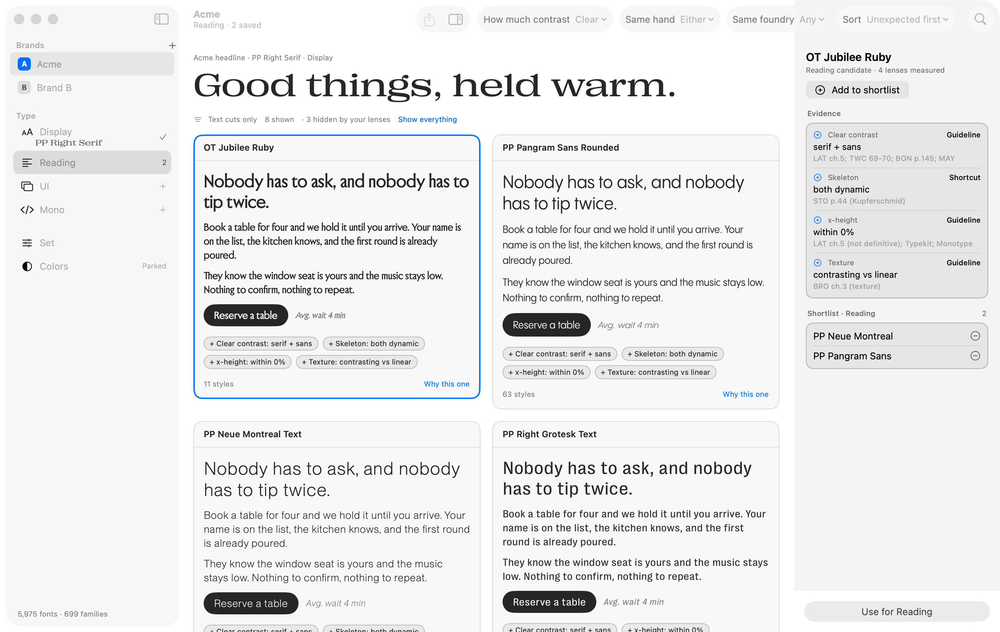
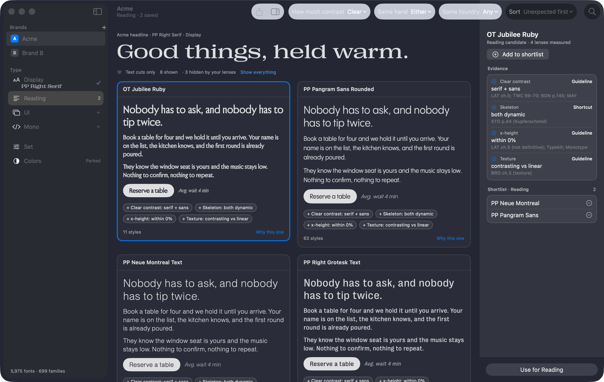

# FontDrop for macOS (SwiftUI)

The SwiftUI app. The Rust engine in `core/` does the work (library DB, classifier, pairing, brands, shortlists). SwiftUI draws it. Fonts are drawn by Core Text.

Wave 2: app shell, Display, Reading, a placeholder Set. See `LEARN.md` for SwiftUI notes mapped to React.

| Light | Dark |
|---|---|
|  |  |
|  |  |

## Run it in Xcode

1. Build the Rust core once (about 3 minutes the first time): `core/build-swift.sh`. It writes the XCFramework and the generated Swift into `macos/FontDropCore` (git-ignored). Needs Rust (`~/.cargo/bin/cargo`).
2. Open `macos/FontDrop.xcodeproj`.
3. Pick the **FontDrop** scheme and **My Mac**, then press Run (Cmd-R). If Xcode asks for a signing team, choose "Sign to Run Locally" under Signing & Capabilities. No account is needed.

The app opens the shared library DB (`~/Library/Application Support/co.dynolabs.fontdrop/fontdrop.db`), the same one the Tauri app uses. Opening runs schema migrations. Brands, shortlists and choices are saved there.

To work on a copy instead (do this for anything that writes test data):

```
sqlite3 "$HOME/Library/Application Support/co.dynolabs.fontdrop/fontdrop.db" ".backup '/tmp/fontdrop-copy.db'"
macos/build/FontDrop.app/Contents/MacOS/FontDrop --db /tmp/fontdrop-copy.db
```

In Xcode: Product > Scheme > Edit Scheme > Run > Arguments, add `--db /tmp/fontdrop-copy.db` (or the environment variable `FONTDROP_DB`). DB path order: `--db`, `$FONTDROP_DB`, the shared DB.

## Build from the terminal

```
macos/build.sh                  # macos/build/FontDrop.app (runs core/build-swift.sh first if the XCFramework is missing)
macos/build.sh --run            # build and open
macos/build.sh --test           # unit tests (Lens filters)
macos/build.sh --rebuild-core   # regenerate the Rust lib and Swift bindings, then build
```

`project.yml` is the XcodeGen spec. `build.sh` regenerates `FontDrop.xcodeproj` from it when it is newer (`brew install xcodegen`). Both are committed. Bundle id `co.dynolabs.fontdrop.mac`. macOS 14+, Apple Silicon (the core XCFramework is arm64 only).

## Developer flags

| Flag | What it does |
|---|---|
| `--db <path>` | Use this library DB. |
| `--brand <name>` | Start with this brand selected. |
| `--refresh` | Rescan the disk and reclassify before showing the library (can take a minute or more). |
| `--screenshot <png> [--screen display\|reading\|set] [--appearance light\|dark] [--select <family>] [--no-inspector]` | Render the window to a PNG and quit. It captures the app's own window in-process (no screen-recording permission). |
| `--bench` | Print load times and scroll frame times for the Display grid and Reading, then quit. |

Screenshots in `docs/` were made with `--db <copy>`, brand "Acme" (a demo brand added to the copy only).

## How it is put together

```
Sources/FontDrop/
  FontDropApp.swift   entry point, window
  AppModel.swift      the store: library, brands, choices, shortlist, candidates; launch options
  FontLoader.swift    Core Text loader and cache (preloaded off the main thread)
  Lenses.swift        Reading lenses: pure filter and sort over core evidence
  RootView.swift      NavigationSplitView + inspector + toolbar + routers
  SidebarView.swift   Brands, Type, Set, Colors
  DisplayView.swift   family grid (Display, UI, Mono) and its inspector
  ReadingView.swift   lens menus, candidate cards, evidence inspector, shortlist
  SetView.swift       placeholder
  Components.swift    FontText, chips, tags, flow layout, inspector section
  Bench.swift         --screenshot and --bench
Tests/FontDropTests/  lens tests (neutral fixture names)
FontDropCore/         local Swift package: generated UniFFI bindings + XCFramework (git-ignored output)
```

Rules that came out of the spike (wave 0):

- Fonts load in the model, off the main thread, in batches (`FontLoader.preload`). Rows read the cache and never write state. Loading from each row caused multi-second stalls.
- All DB work goes through `AppModel.background`, a detached task. The UI thread never waits on SQLite.

## Measurements (wave 2)

Apple Silicon Mac, 60 Hz display, window 1360x860. The `--bench` harness scrolls the real `NSScrollView` behind the grid at 6,000 pt/s on a display link.

Current library (rescanned DB copy: 699 families, 5,975 files):

- Open and migrate 95 ms. `list_families` + `list_fonts` + brands 66 ms. Preload 699 family fonts 59 ms.
- Display grid, 5 passes of 42,558 pt (426 frames each): p50 = p95 = p99 = 16.7 ms. 0 to 1 late frames per pass, max 33 ms. No severe hitches.
- Reading (11 candidates): ready 289 ms after switching to the screen; scroll passes 8 to 9 frames, max 33 ms.
- Memory: 80 MB after load, 120 MB after scrolling the grid.

Stress case (stale DB copy: 3,339 "families", one card per style file):

- Preload 245 ms. Five passes of 206,238 pt (about 2,060 frames each): p99 16.7 ms. Two passes had a 160 and a 207 ms frame (4 and 1 severe frames out of about 2,060). Memory 113 to about 300 MB.

## Known gaps

See the final report of wave 2 in the PR/handoff notes. Short list: no Claude advise box, no "Like my picks" sort, no popularity data (so "Unexpected first" uses fewer shortcut reasons), UI and Mono reuse the Display grid, Export is a disabled placeholder.
