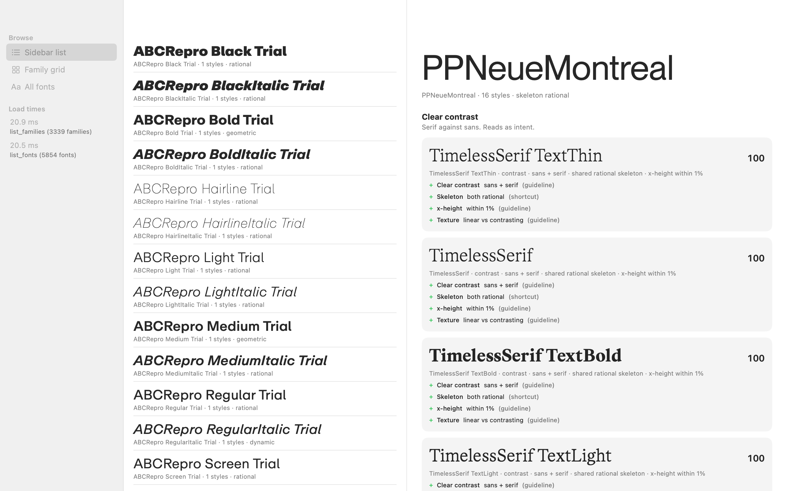

# FontDrop macOS (SwiftUI spike, wave 0)

Proves the architecture: Rust core -> UniFFI -> SwiftUI window that lists every family in its own font via Core Text and shows real pairing results with evidence.



## Build and run

```
macos/build.sh            # builds macos/build/FontDrop.app (runs core/build-swift.sh first if bindings are missing)
macos/build.sh --run      # build and open
macos/build.sh --rebuild-core   # regenerate Rust lib + Swift bindings from scratch, then build
open macos/build/FontDrop.app
```

`core/build-swift.sh` alone: cleans, builds `libfontdrop_core.a` (release, aarch64-apple-darwin, deployment target 14.0), generates Swift with UniFFI 0.32.2 (library mode, proc-macros, no .udl), wraps lib + header + modulemap in an XCFramework, writes it into the local Swift package `macos/FontDropCore`. Generated files are git-ignored. First run compiles ~3 minutes (uniffi + bundled SQLite).

Flags: `--db <path>` (or `$FONTDROP_DB`; default is the real app DB, opened read-only), `--bench`, `--bench --hot`, `--bench --prefetch-only`, `--screenshot <png> [--select <family>] [--mode <name>]`. Screenshot renders in-process with `cacheDisplay`, no screen-recording permission.

## Architecture choice

- **Core**: `core/` crate, UniFFI proc-macros. Exports `list_families`, `list_fonts` (spike extra, for the flat list), `font_pairs`. `core/src/pairing.rs` is a copy of `src-tauri/src/pairing.rs` minus the Tauri command, serde and tests. `src-tauri` is untouched (`cargo test --lib`: 22 passed, 6 ignored).
- **App**: SwiftPM executable + a 40-line script that wraps it as a `.app`, not an Xcode project. Why: no pbxproj to merge, one command builds from the terminal, diffs read cleanly, works with agents. Cost: no asset catalog, entitlements, signing, notarisation or Instruments templates from the project. Wave 2 (app shell) should move to an Xcode project that references the same `FontDropCore` package.
- **Fonts**: `CTFontManagerCreateFontDescriptorsFromURL` on the file, first descriptor (so `.ttc` -> first face), `CTFontCreateWithFontDescriptor`, shown with `Font(CTFont)`. No global registration. Loading runs off the main thread, cached per path.
- **UI**: three-column `NavigationSplitView`: modes + load times, browse column (List of families, LazyVGrid of families, or List of all 5,854 files), detail with pairs.

## Measurements

Machine: Apple Silicon Mac, macOS 26.6, display link at 60 Hz (16.7 ms frame). DB copy: 5,854 font files, **3,339 "families"** (not ~380: `font_family` in the DB includes style words, e.g. "ABCRepro Black Trial" is its own family; 1,301 have 2+ files). No `.ttc` files in the DB.

| What | Result |
|---|---|
| `list_families` (3,339 rows) | 15-39 ms across runs (typ. 26) |
| `list_fonts` (5,854 rows) | 17-26 ms |
| `font_pairs` (full library scored) | 11-13 ms (after DB migration, see problems) |
| Core Text load of all 5,854 files, 8 workers | ~300 ms total, per file p50 0.26 ms, p95 0.8 ms, max 33 ms |
| Memory (phys footprint) | 45-70 MB at start, ~125 MB with every descriptor cached, 270-360 MB after scrolling 3,339 grid cells |
| Fonts that fail | 1 unreadable by Core Text; 151 load but cannot draw the family name or "Hamburgefonstiv" (Braille, SF Arabic/Hebrew/Georgian/Armenian, Noto script fonts). The row falls back to the system font in grey. |

Scroll test: `--bench` drives the real `NSScrollView` behind the SwiftUI list/grid at 6,000 pt/s on a display link (dt capped at 50 ms) and logs frame intervals. This is close to, not the same as, trackpad scrolling.

**Fonts preloaded (`--bench --hot`), every mode, 6 passes: smooth.** p99 = 16.7 ms in all; 0-2 late frames per ~1,600 (max 40 ms); zero severe hitches. That covers List of families, LazyVGrid of 3,339 cells, and a flat List of 5,854 rows.

**Fonts loaded lazily from each row (`--bench`, the default code path): NOT smooth.** Between stalls it is fine (0.1-1.0% late frames, p99 16.7 ms), but almost every run had one or more main-thread stalls of 1.4 s to 96 s in some mode (flat list, grid, or list). Jump-scrolling itself is cheap (35-45 ms for 20/50/90% jumps), so it is not scroll distance. The stall appears when rows write `@State` from an async task while the table is being laid out (AppKit logs "reentrant operation in its NSTableView delegate"). Not proven further; the preloaded run is the control. Confounds: the old Tauri FontDrop was open on the same machine; one early run used an in-process `sample` watchdog (since made opt-in with `--watch`).

Things I tried that did not help: fixed row heights (`.frame(height:)`) made it no better. A `List` still uses automatic row heights in NSTableView, which is also why a first run with a far scroll showed a stall inside `_automaticRowHeightsUpdateVisibleRowViews`.

## Problems hit

1. **The real DB is behind the schema.** `core` queries `vendor_id`, which the Tauri app adds with a migration at launch. The DB on disk (written by an older build) lacked it, so `font_pairs` failed. My first Swift code swallowed the error with `try?` and showed "No pairs". Fixed in the spike by showing the error and adding the column to the scratch copy. For the port: **the core must own migrations**, or at least detect and report schema mismatch.
2. Worktree started from an older commit than `fonts-first-rethink` (no `pairing.rs`); fast-forwarded to it. `docs/ideas/swiftui-plan.md` is untracked in the main checkout, so it is not in this branch.
3. Rust static lib was built for the SDK's macOS 27 target and the linker warned. Fixed with `MACOSX_DEPLOYMENT_TARGET=14.0` in `build-swift.sh`.
4. UniFFI Swift output is Swift 5 style; the wrapper package pins Swift 5 language mode for that one target. The app target is Swift 6 mode and compiled clean.
5. SwiftPM links the binary XCFramework fine, but the Rust lib is 100% static, so the app binary carries SQLite (bundled).

## Notes for the port

- `core/src/pairing.rs` is a copy. Move it to core and make src-tauri depend on core; the tests need to move with it.
- `list_families` picks "upright nearest 400" using the `style` column plus file name; `db.rs::unify_family_skeletons` uses file name only. A few families may differ.
- `font_pairs` re-scans the table for `file_path`; fold it into `load_all_fonts`.
- `FamilySummary.serif` is `flesh_serif != 0`.

## Wave 1 update: one shared engine

The engine now lives only in `core/` (db, scan, classifier, metrics, pairing, userdata, google_fonts, name-table helpers). `src-tauri` is a thin shell that depends on it by path. The Swift surface is behind the core's `uniffi` feature (off by default, so the Tauri app does not carry the FFI scaffolding; `core/build-swift.sh` turns it on).

Swift calls one object: `Library.open(path:)` (runs migrations), then `listFamilies()`, `listFonts()`, `fontPairs(fontId:excludedIds:job:)`, brands CRUD, `shortlistGet/Set`, `choose/choices`, `houseStyle()`, `refreshLibrary()` (scan + classify on its own connection; call from a background task). Errors are the `CoreError` enum. `--refresh` runs it from the app.

Against a rescanned DB copy the family list is the current model: 709 families from 5,982 files (the spike's 3,339 came from a stale DB). Screenshot: `docs/screenshot-wave1.png`.
